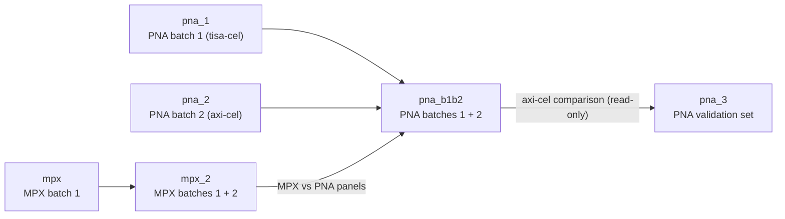

# MPX and PNA analysis of clinical CAR T samples (Kashima et al, 2026)

Analyses for the MPX and PNA CAR-T studies: `mpx/`, `mpx_2/`, `pna_1/`, `pna_2/`, `pna_3/` and `pna_b1b2/`.

## About the project

This repository holds the downstream analysis code for a clinical CD19 CAR-T study profiled with two Pixelgen assays: Molecular Pixelation (MPX) and the Proximity Network Assay (PNA). The study compares the CAR-T product (`t0`) with PBMCs 7–11 days after infusion (`t1`). The MPX batch 1 dataset also includes later timepoints (`t2` and `t3`).

- Two CAR constructs are included, tisa-cel and axi-cel. Both carry the FMC63 anti-CD19 scFv, which is detected with an FMC63 add-on antibody and used to define CAR+ (FMC63+) cells.
- Donors are pseudonymised (donorA–donorN).
- MPX is the primary dataset. PNA validates the MPX findings and extends them to a second construct.
- PNA uses the Proxiome Kit v2 (Immuno 155 panel) plus the FMC63 add-on and three isotype controls. The MPX analysis covers 81 markers.

## Project folders and datasets

| Folder | Assay | Dataset | Contents |
|---|---|---|---|
| `mpx/` | MPX | Batch 1 (t0–t3) | Processing, t0/t1 analysis, later-timepoint analysis, figure updates (Quarto in `scripts/`) |
| `mpx_2/` | MPX | Batches 1 + 2 combined (t0 and t1, 14 samples, 8 donors) | Combined analysis and manuscript figures for MPX (`scripts/`) |
| `pna_1/` | PNA | Batch 1, tisa-cel (8 samples, 5 donors) | Proxiome Analysis Template (PAT) project, all samples plus a t0 product-only sub-analysis |
| `pna_2/` | PNA | Batch 2, axi-cel (8 samples, 6 donors) | PAT project |
| `pna_b1b2/` | PNA | Batches 1 + 2 combined (16 samples, 11 donors) | Combined analysis, platelet clean-up and manuscript figures for PNA |
| `pna_3/` | PNA | Separate axi-cel validation set (5 samples) | Same workflow as `pna_b1b2`, compared with its axi-cel samples |

Each project documents its own samples in `data/metadata.csv` (`data/sample_metadata.tsv` for the MPX projects) and, for the PNA projects, in its README.

## How the projects relate



- `pna_b1b2` reads the PXL files in place from `pna_1/` and `pna_2/`, so do not move or rename those folders.
- `mpx_2` starts from the processed batch 1 object created in `mpx/`.
- The MPX vs PNA comparison panels in `pna_b1b2` use results from `mpx_2`.
- `pna_3` is analysed on its own and compared with the axi-cel samples of `pna_b1b2` (read-only, descriptive).

## Manuscript figures

| Figures | Code | Output location (created when run) |
|---|---|---|
| MPX | `mpx_2/scripts/02_analysis_b1b2.qmd` (panels flagged `Manuscript:`) | `mpx_2/results/b1b2_t0t1/revised_figs/` |
| PNA | `pna_b1b2/modules/08_manuscript_figures.qmd` | `pna_b1b2/results/08_manuscript_figures/` |
| PNA validation (supplementary) | `pna_3/modules/08_manuscript_figures.qmd` | `pna_3/results/08_manuscript_figures/` |

- The PNA differential results behind the figures are created in `pna_b1b2/results_cleaned/05_statistical_testing/`.
- One PNA panel (cell graph layouts) was generated in a separate project that is not part of this repository.

## Replicating the manuscript figures

1. Place the PXL files in the `data/` folders (see [Data and outputs](#data-and-outputs)).
2. Restore the R environment (see [R environment](#r-environment)).
3. MPX figures: render, in this order, `mpx/scripts/01_processing_all_gating.qmd`, `mpx_2/scripts/01_processing_all_gating.qmd`, `mpx_2/scripts/01_processing_t0.qmd` and `mpx_2/scripts/02_analysis_b1b2.qmd`.
4. PNA figures (run after step 3, because module 08 reads MPX results from `mpx_2/results/b1b2_t0t1/`): in `pna_b1b2/modules/` run `01`, `02` and `02b` (platelet clean-up, a long run with high memory use; set `run_cleanup <- TRUE`), then `pna_b1b2/modules_cleaned/05_statistical_testing_cleaned.qmd`, then `08_manuscript_figures.qmd`.
5. PNA validation set (supplementary figures): in `pna_3/modules/` run `01`, `02` and `02b`, then `08_manuscript_figures.qmd`. Panels S15–S20 also need the platelet-cleaned object from step 4.

## Data and outputs

The PXL data files and the analysis outputs (`results*/`, `rdata/`) are not included in this repository. The `data/` folders contain the sample metadata only. To replicate an analysis, place the PXL files listed in the project's metadata file (`data/metadata.csv`, or `data/sample_metadata.tsv` for the MPX projects) in that project's `data/` folder. `pna_b1b2` reads the PXL files in place from `pna_1/data/` and `pna_2/data/`. Outputs are created in `results*/` and `rdata/` when the analyses are run.

## R environment

All folders share one [renv](https://rstudio.github.io/renv/) project at the root directory.

- R 4.4.3, Bioconductor 3.20, Quarto 1.6.42
- Package versions are recorded in `renv.lock`. `pixelatorR` is installed from GitHub (`PixelgenTechnologies/pixelatorR`) and pinned to a commit in the lockfile.
- Each subfolder has a `.Rprofile` that loads the root renv project, so opening a `.Rproj` or rendering a qmd from a subfolder uses the shared library.

To recreate the environment, open R in the root directory and run:

```r
renv::restore()
```

After installing or updating any package, run `renv::snapshot()` from the root and commit `renv.lock`.

`mpx/` also contains a separate conda setup (`environment.yml`, `setup_conda_install_r_pkgs.sh`) that is not covered by `renv.lock`.
